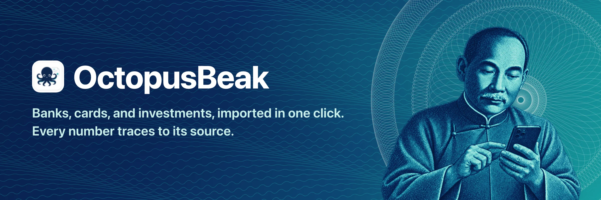

# OctopusBeak

[繁體中文](README.md)

Bring data scattered across bank accounts, brokerage accounts, and E-Invoices back to your Mac. OctopusBeak opens provider sites, downloads statements, organizes them in a local ledger, and gives you one place to review assets, liabilities, and spending.

## Download and install

OctopusBeak currently supports **macOS on Apple Silicon (arm64)**. Windows, Linux, and Intel Macs are not supported yet.

[Download the latest OctopusBeak release](https://github.com/WangWilly/OctopusBeak/releases/latest)

1. Download the DMG from the latest release.
2. Open it and drag OctopusBeak into Applications.
3. Launch OctopusBeak from Applications.

The DMG is the recommended installer. A ZIP and `SHA256SUMS.txt` are also available on the release page.

## What you can do

### Review assets and liabilities together

The overview combines imported bank deposits, foreign currency, funds, brokerage accounts, crypto assets, and loans. Daily snapshots show changes over time, allocation, and liability exposure.


### Inspect asset changes and account details

The Assets page groups bank, fund, brokerage, crypto, and foreign-currency accounts. Review balance trends, then open an account to inspect trades or positions.


### Track credit cards and loans

The Liabilities page shows credit-card and loan balance trends, upcoming payments, and credit utilization. Filter by credit cards or loans, then open an account to inspect its transactions, history, and statements.


### Organize E-Invoices and account spending

The Spending page combines E-Invoices and account expenses, grouped by month and category. You can inspect invoice items and correct their categories. In Merge review, merge an invoice with the payment for the same purchase so the purchase is counted once.


### Collect data from the desktop app

The Automation page keeps sources, sign-in details, and run history in one place. Enable each source separately and choose which statement types to collect. With Daily scheduled collection on, the App syncs every enabled source at a set time while it is open and sends one notification afterward with the result and any source that needs attention. A sync you start notifies you too when you are away from the App. Foreign-currency and crypto exchange rates update once a day.


## First run

1. Open OctopusBeak and use Welcome to choose a language and whether to start setup.
2. Choose one source, enter its sign-in details, and select statement types.
3. Start collection. The App solves provider CAPTCHAs on your device. Some sources need extra preparation:
   - Cathay and TDCC e-Passbook: register this device once in the source's sign-in settings before the first run. TDCC trusts one device at a time, so every sync signs the TDCC e-Passbook phone App out. If you sign in to the phone App again, register this device again before the next sync.
   - Yuanta Trade: install Yuanta's official ServiSign security component, as described in its sign-in settings.
4. The app validates source completeness and writes accepted data directly to the local database.
5. Return to Overview to review the result.

The app remembers onboarding progress, so you can quit and continue later. You can also restart onboarding from Settings.

## Supported sources

| Source | Available data |
| --- | --- |
| Fubon | TWD deposits, credit cards, loans |
| ESun | Credit cards |
| Yuanta | TWD deposits, foreign currency, loans, credit cards, funds |
| Yuanta Trade | Positions and trades |
| Cathay | TWD deposits and foreign currency |
| HNCB | TWD deposits |
| CTBC | TWD deposits |
| Post Office | TWD deposits |
| SinoPac | TWD deposits, foreign currency |
| LINE Bank | TWD deposits and foreign currency |
| E-Invoice | Personal invoices and purchased items |
| MAX / MaiCoin | Crypto balances and statement rows |
| TDCC e-Passbook | Securities, funds, settlement accounts |

Foreign-currency transaction details are currently supported for SinoPac, Yuanta, Cathay, and LINE Bank.

### Preview sources

Turn on Preview features in Settings to connect the following sources, which have not been verified with real accounts. This is an experimental feature.

| Source | Available data |
| --- | --- |
| Next Bank | Deposits, time deposits |
| Shin Kong Bank | Deposits, credit cards |
| Rakuten | Deposits |
| Mega Bank | Deposits, credit cards |
| Taishin | Deposits, credit cards |
| O-Bank | Deposits, time deposits |
| First Bank | Deposits, credit cards |
| KGI Bank | Deposits |
| CTBC | Credit cards |
| Cathay | Credit cards, time deposits, collected in the same sign-in as the verified source |
| HNCB | Credit cards, collected in the same sign-in as the verified source |
| SinoPac | Credit cards, collected in the same sign-in as the verified source |
| ESun | Deposits, collected in the same sign-in as the verified source |

Preview data is stored apart from verified data. Preview balances count toward assets, liabilities, and net worth with a preview marker; preview transactions appear only in their account's details, outside spending and categories. Turning Preview features off hides preview sources and their data but keeps the data. You can delete all preview data in Settings.

## Your data stays on your device

Financial records, automation settings, and run summaries are stored in the local database. The app processes source content in memory without saving source downloads, generated CSV/JSON, or raw logs; structured run events are kept for 30 days. Sign-in details stay on your Mac and are encrypted with Electron `safeStorage`. If secure encryption is unavailable, OctopusBeak stops at startup instead of writing plaintext passwords.

CAPTCHAs, OTPs, session cookies, and other authentication material are not sent to a model. CAPTCHAs are solved by an on-device recognizer, and audio CAPTCHAs by on-device speech recognition. A verification the App cannot complete fails that run and shows the reason.

When a preview source run fails, you can use Share structure report in its run details to help improve that source. The report describes only the field structure of the responses, never account numbers, names, amounts, dates, or other content. You review the full report and paste it into a prefilled public GitHub issue yourself; the App sends nothing.

### Anonymous usage statistics (off by default)

The App asks you once, in a dialog, whether to turn on Usage statistics; the answer is never preselected, and you can change it later in Settings. Only after you turn it on does the App send one anonymous report a day: the app version, the macOS version (major and minor only), the macOS language (Chinese or English), the week you first opened the app, and how many times each data source failed in the past week, with the error code and stage. It tells us how many people keep using OctopusBeak and which sources break. The report carries no financial data, sign-in details, or run results, and no device identifier; the server keeps only daily totals, for two years, never individual reports or IP addresses. Cloudflare, which receives it, sees the connecting network address as any website would. Settings shows the exact content of the next report, and you can turn it off at any time.

### Reporting an error (you decide)

When a run fails, its details offer Report this error. It first shows exactly what will be sent and sends nothing until you select Send. The report holds the data source, error code, stage, app and macOS versions, and a technical record of where in the app the error happened; it never holds sign-in details, account numbers, amounts, transactions, or error messages from the bank's site. You may add a note and an email; runs of six or more digits in the note are masked before sending. Reports are kept for one year and seen only by the developer.

## Developer information

<details>
<summary>Run from source</summary>

See the [documentation map](docs/README.md) for authoritative sources and document lifecycle rules.

```bash
npm install
npm run typecheck
npm run desktop:dev
```

The UI is Electron-only and loads the static renderer at `#/overview`.

The development launcher supervises its Electron process group. See [Desktop development lifecycle](docs/runbooks/desktop-development.md) for shutdown, external-volume loss, and recording cleanup.

Build an unsigned local app:

```bash
npm run desktop:package
open out/OctopusBeak-darwin-arm64/OctopusBeak.app
```

See [Desktop release](docs/desktop-release.md) for signing and notarization.

</details>

<details>
<summary>CLI and local ledger</summary>

The desktop app starts production workflows. For typed workflow development, use the project CLI and its fixture:

```bash
npm run workflow:dev -- help
npm run workflow:dev -- list
npm run workflow:dev -- fixture
```

See the [workflow development guide](docs/agents/workflow-development.md) for how to add and test a provider. Run production bank, invoice, and synchronization tasks through the desktop app's automation interface.

Both development and packaged builds store financial data in `~/Library/Application Support/OctopusBeak/data/pglite/`. Set `OCTOPUSBEAK_USER_DATA` to use a different data directory.

</details>

<details>
<summary>Project paths and checks</summary>

| Path | Purpose |
| --- | --- |
| `src/workflows/` | Bank and source workflow definitions; production tasks run through the desktop App's typed runtime |
| `src/ledger/` | Source parsing, PGlite storage, and financial queries |
| `src/lib/overview/`, `src/lib/assets/` | Overview and Assets UI |
| `src/lib/liabilities/` | Liabilities UI |
| `src/lib/spending/` | E-Invoice and spending UI |
| `src/lib/automation/` | Automation UI and server helpers |
| `src/lib/preview-sources/` | Preview source workflows and preview data access |
| `src/lib/settings/` | Settings UI |
| `electron/` | Electron main process and runtime helpers |
| `~/Library/Application Support/OctopusBeak/` | App runtime data, including the local ledger in `data/pglite/` |

Before committing changes, run:

```bash
npm run typecheck
npm run build
npm run privacy-check
npm run secrets-check
```

</details>
