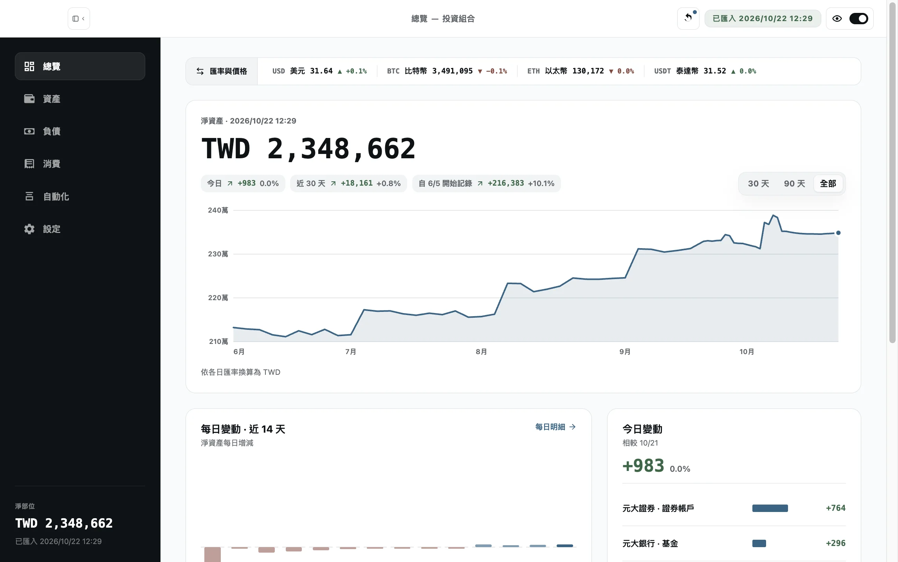
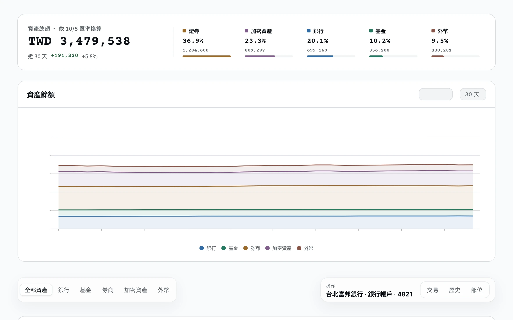
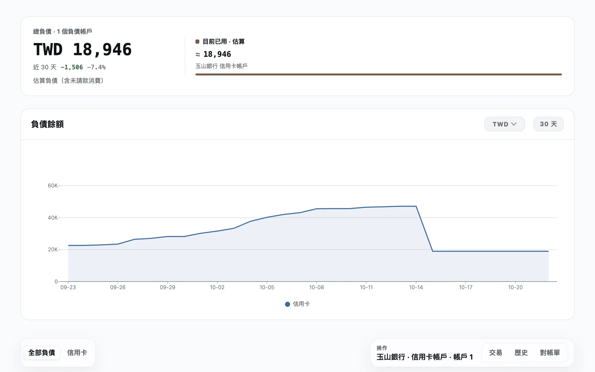
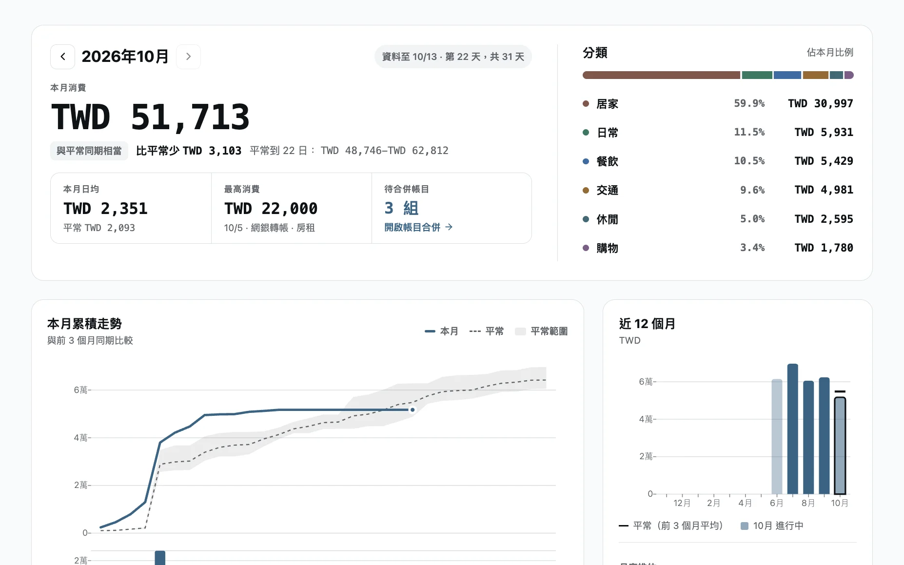
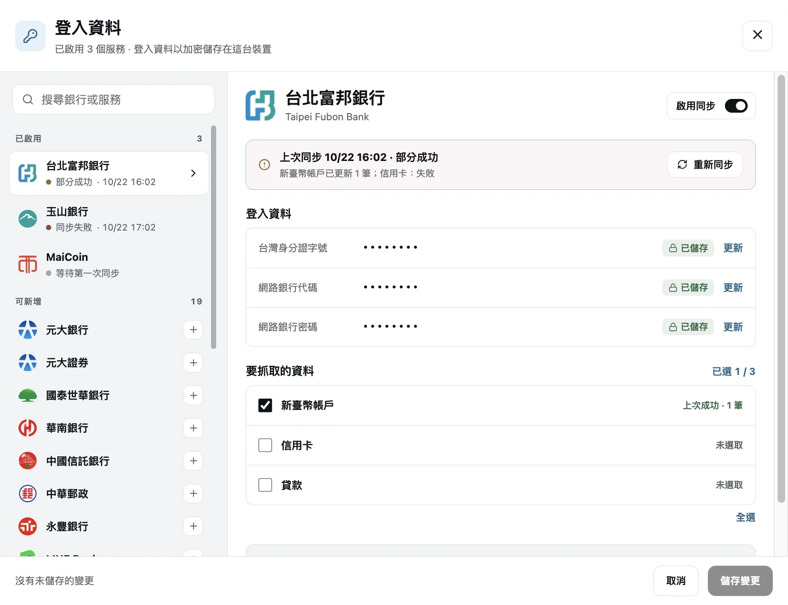

# OctopusBeak

[English](README.en.md)

把散落在銀行、證券帳戶和電子發票裡的資料收回自己的 Mac。OctopusBeak 會開啟金融服務網站、下載對帳單、整理成本機帳本，讓你在同一處查看資產、負債與支出。

## 下載與安裝

目前只提供 **macOS Apple Silicon（arm64）** 版本。Windows、Linux 與 Intel Mac 尚未支援。

[下載最新版 OctopusBeak](https://github.com/WangWilly/OctopusBeak/releases/latest)

1. 從最新版本頁面下載 DMG。
2. 開啟 DMG，將 OctopusBeak 拖進「應用程式」。
3. 從「應用程式」啟動 OctopusBeak。

建議使用 DMG 安裝。也提供 ZIP，並附上 `SHA256SUMS.txt` 供你核對檔案。

## 你可以用它做什麼

### 把資產與負債放在同一張總覽

總覽會整理匯入的銀行存款、外幣、基金、證券、加密資產與貸款。快照歷史保留每天的變化，也能看出資產配置和負債曝險。



### 查看資產變化與帳戶明細

資產頁依銀行、基金、券商、加密資產與外幣分組。你可以查看餘額趨勢，再往下查交易或持倉。



### 掌握信用卡與貸款

負債頁列出信用卡與貸款的餘額趨勢、近期應繳款項與信用卡使用率。你可以依信用卡或貸款篩選，再查看單一帳戶的交易、歷史與對帳單。



### 整理電子發票與帳戶支出

消費頁把電子發票和帳戶支出放在一起，依月份與類別統計。發票品項可以逐筆查看，也能自行修正分類。同一筆消費的發票與付款紀錄可以在「帳目合併」中合併，合併後只計算一次。



### 從桌面程式收集資料

自動化頁面集中管理資料來源、登入資料、與執行紀錄。每個來源可以個別啟用，並選擇要收集的對帳單類型。開啟「每日排程收集」後，App 開著時會在指定時間同步所有已啟用的來源，需要你處理的來源會發送通知。外幣與加密資產匯率每天自動更新一次。



## 第一次使用

1. 開啟 OctopusBeak，在歡迎畫面選擇語言與是否開始設定。
2. 選擇一個資料來源，填入登入資料和要收集的對帳單類型。
3. 執行資料收集。網站要求的 CAPTCHA 由 App 在本機自動辨識。部分來源需要額外準備：
   - 國泰世華與集保e手掌握：第一次同步前，請先在登入設定中完成一次裝置註冊。集保一次只信任一台裝置，每次同步都會登出集保手機 App；若你重新登入手機 App，下次同步前需要再註冊一次。
   - 元大證券：請先依登入設定的說明安裝元大官方的 ServiSign 安全元件。
4. App 驗證來源完整性後，直接將可接受的資料寫入本機資料庫。
5. 回到總覽查看結果。

程式會記住初始設定的進度。中途關閉也沒關係，下次開啟可以接著做；日後也能從設定重新開始。

## 支援的資料來源

| 資料來源 | 可收集資料 |
| --- | --- |
| 台北富邦銀行（Fubon） | 台幣存款、信用卡、貸款 |
| 玉山銀行（ESun） | 信用卡 |
| 元大銀行（Yuanta） | 台幣存款、外幣、貸款、信用卡、基金 |
| 元大證券（Yuanta Trade） | 持倉與交易紀錄 |
| 國泰世華銀行（Cathay） | 台幣存款、外幣 |
| 華南銀行（HNCB） | 台幣存款 |
| 中國信託銀行（CTBC） | 台幣存款 |
| 中華郵政（Post Office） | 台幣存款 |
| 永豐銀行（SinoPac） | 台幣存款、外幣 |
| LINE Bank | 台幣存款、外幣 |
| 電子發票（E-Invoice） | 發票與消費品項 |
| MAX / MaiCoin | 加密資產餘額與交易紀錄 |
| 集保e手掌握（TDCC e-Passbook） | 證券、基金、交割帳戶 |

外幣交易明細目前支援永豐、元大、國泰世華與 LINE Bank。

### 預覽來源

在設定中開啟「預覽測試功能」後，可以連接下列尚未以實際帳戶驗證的來源。這是實驗性功能。

| 資料來源 | 可收集資料 |
| --- | --- |
| 將來銀行（Next Bank） | 存款、定存 |
| 新光銀行（Shin Kong Bank） | 存款、信用卡 |
| 樂天國際銀行（Rakuten） | 存款 |
| 兆豐銀行（Mega Bank） | 存款、信用卡 |
| 台新銀行（Taishin） | 存款、信用卡 |
| 王道銀行（O-Bank） | 存款、定存 |
| 第一銀行（First Bank） | 存款、信用卡 |
| 凱基銀行（KGI Bank） | 存款 |
| 中國信託銀行（CTBC） | 信用卡 |
| 國泰世華銀行（Cathay） | 信用卡、定存，隨既有來源登入一併收集 |
| 華南銀行（HNCB） | 信用卡，隨既有來源登入一併收集 |
| 永豐銀行（SinoPac） | 信用卡，隨既有來源登入一併收集 |
| 玉山銀行（ESun） | 存款，隨既有來源登入一併收集 |

預覽資料與已驗證的資料分開保存。預覽餘額會計入資產、負債與淨資產，並加上預覽標示；預覽交易只顯示在該帳戶的明細，不列入消費與分類。關閉預覽測試功能會隱藏預覽來源與其資料，但資料仍會保留，你可以在設定中刪除所有預覽資料。

## 資料留在你的裝置

帳務資料、自動化設定與執行摘要都存放在本機資料庫。App 在記憶體中處理來源內容，不另外保存來源下載檔、產生的 CSV／JSON 或原始日誌；結構化執行事件保留 30 天。登入資料也只存在你的 Mac，並由 Electron `safeStorage` 加密；如果系統無法安全加密，OctopusBeak 會停止啟動，不會把密碼寫成明文。

CAPTCHA、OTP、工作階段 Cookie 與其他驗證資訊不會交給模型處理。CAPTCHA 由裝置上的辨識程式在本機解答，語音 CAPTCHA 也在本機進行語音辨識；無法自動完成的驗證會讓該次收集失敗並顯示原因。

預覽來源執行失敗時，你可以在執行紀錄中「分享結構報告」，協助改善該來源。報告只描述回應的欄位結構，不含帳號、姓名、金額、日期或其他內容。你檢視完整報告後，自行貼到預先開好的公開 GitHub issue；App 本身不會傳送任何資料。

## 開發者資訊

<details>
<summary>從原始碼執行</summary>

專案文件的權威來源與維護方式請見[文件索引](docs/README.md)。

```bash
npm install
npm run typecheck
npm run desktop:dev
```

桌面介面僅支援 Electron，並從 `#/overview` 載入靜態渲染器。

開發啟動器會監督該次 Electron 程序群組；關閉、外接磁碟失聯與錄影後清理方式請見[桌面開發生命週期](docs/runbooks/desktop-development.md)。

建立未簽署的本機應用程式：

```bash
npm run desktop:package
open out/OctopusBeak-darwin-arm64/OctopusBeak.app
```

簽署與公證流程請參閱[桌面版發行文件](docs/desktop-release.md)。

</details>

<details>
<summary>CLI 與本機帳本</summary>

正式工作流程由桌面 App 啟動。開發 typed workflow 時，使用專案 CLI 與測試 fixture：

```bash
npm run workflow:dev -- help
npm run workflow:dev -- list
npm run workflow:dev -- fixture
```

新增與測試 workflow 的步驟請參閱[開發指引](docs/agents/workflow-development.md)。正式的銀行、發票與同步工作請從桌面 App 的自動化介面執行。

開發版與安裝版都把金融資料存在 `~/Library/Application Support/OctopusBeak/data/pglite/`。設定 `OCTOPUSBEAK_USER_DATA` 可改用其他資料目錄。

</details>

<details>
<summary>專案路徑與檢查指令</summary>

| 路徑 | 用途 |
| --- | --- |
| `src/workflows/` | 銀行與來源工作流程定義；正式工作由桌面 App 的 typed runtime 執行 |
| `src/ledger/` | 來源解析、PGlite 儲存與財務查詢 |
| `src/lib/overview/`、`src/lib/assets/` | 總覽與資產介面 |
| `src/lib/liabilities/` | 負債介面 |
| `src/lib/spending/` | 電子發票與消費介面 |
| `src/lib/automation/` | 自動化介面與伺服器端輔助程式 |
| `src/lib/preview-sources/` | 預覽來源工作流程與預覽資料讀寫 |
| `src/lib/settings/` | 設定介面 |
| `electron/` | Electron 主程序與執行環境輔助程式 |
| `~/Library/Application Support/OctopusBeak/` | App 執行資料，含 `data/pglite/` 本機帳本 |

提交變更前請執行：

```bash
npm run typecheck
npm run build
npm run privacy-check
npm run secrets-check
```

</details>
